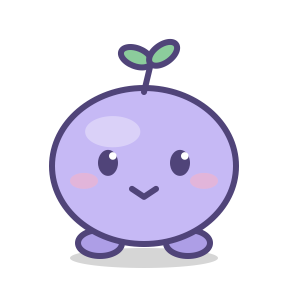

# Claude Buddy

A native macOS desktop companion for Claude Code. Mochi sits above your windows, animates while Claude works, and shows replies in a speech bubble. Built with Swift and AppKit.



## Features

- Talk to Claude through a small input box and configurable global shortcuts.
- Follow work in other Claude Code sessions through optional hooks.
- Open the related session in the Claude desktop app, with a terminal fallback.
- Change pet size, sleep timing, working folder, and startup behavior.
- Use Mochi's idle, talking, sleeping, and dragging animations, or import a custom skin.

This is an independent companion for Claude Code. It requires an installed, authenticated Claude Code CLI. It does not currently run Codex conversations.

## Build and run

Requires macOS 14 or later and a Swift 6 toolchain. Xcode Command Line Tools are sufficient; no Xcode project is required.

```sh
make run
```

To install the app in `~/Applications`:

```sh
make install
```

The app is signed locally during the build. No notarized download is provided. Open the app through `make run`, `make install`, or Finder so it starts outside the CLI session's environment.

Right-click Mochi to open Settings. Choose a working folder and, if automatic discovery fails, the path to your `claude` executable. The working folder defaults to your home folder.

## Shortcuts

| Shortcut | Action |
| --- | --- |
| Control + Option + Space | Talk to the pet |
| Control + Option + L | Open the last reply's session |
| Control + Option + N | Start a new chat |

Shortcuts can be changed in Settings and use macOS hotkeys without Accessibility permission.

## Follow other sessions

```sh
make hooks          # install hooks, backing up existing settings
make hooks-status   # inspect installation
make unhooks        # remove the companion's hooks
```

Hooks merge into `~/.claude/settings.json` and send events to a local Unix socket. The companion can summarize replies from other sessions through Haiku; that option makes additional Claude requests and can be disabled in Settings.

## Pet skins

Mochi is the only bundled pet. A skin contains a `manifest.json` and PNG sprite strips. See [the Mochi manifest](Skins/default/manifest.json) for the format and [CLAUDE.md](CLAUDE.md) for animation details.

```sh
make skin
python3 scripts/import-codex-pet.py /path/to/spritesheet.png my-pet "My pet"
```

The importer reads a compatible Codex pet sheet; it does not connect the app to Codex. User skins live in `~/Library/Application Support/ClaudeBuddy/Skins/`.

## Development

| Command | Purpose |
| --- | --- |
| `make build` | Compile the release executable |
| `make app` | Build, bundle, and locally sign the app |
| `make stop` | Stop the running companion |
| `make mem` | Inspect memory and CPU use |
| `make clean` | Remove generated build files |

`Sources/ClaudeBuddy/` contains the UI, CLI runner, hook server, and animation code. `Tools/make-skin.swift` generates Mochi's sprites. Local settings use the `io.github.tooolip.claude-buddy` preferences domain. Changing from an older build's preferences domain starts with fresh defaults.

Session-opening links use an undocumented Claude desktop URL scheme and may need updates when that app changes.
